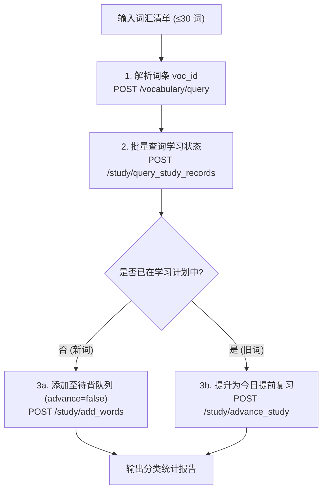

# MaiMemo (墨墨背单词) Open API 纯单词推送契约规范

本文档为考研英语二翻译私教专属的墨墨背单词 Open API 纯单词推送规范。根据用户教学决议，**彻底取消云词本（`/notepads`）维护，亦不创建例句（`/phrases`）**，完全对齐考研英语阅读 Skill (`free-kaoyan-reading`) 的纯单词推送体系。

---

## 一、基础配置与认证

- **Base URL**: `https://open.maimemo.com/open/api/v1`
- **认证方式**: HTTP 请求头 `Authorization: Bearer $MAIMEMO_TOKEN`
- **Token 来源与缺省处理**:
  - 脚本自动读取环境变量 `MAIMEMO_TOKEN`（亦支持命令行传参 `--token`）；
  - 若未设置，脚本清晰报错提示用户配置，不静默失败。
- **频控限制 (Rate Limits)**:
  - 20 次 / 10 秒
  - 40 次 / 60 秒
  - 2000 次 / 5 小时
  *(注：脚本内部内置滑动窗口限流器，请求间隔平均 ≥0.5 秒，确保安全不超频。)*

---

## 二、保留的 3 大核心端点与业务流



### 1. 词条查询与 voc_id 解析 (`POST /vocabulary/query`)
- **作用**：将篇末审阅通过的核心单词与词组解析为墨墨内部唯一的 `voc_id`。
- **短语分词与核心词提取**：
  - 若词组未直接被墨墨收录，脚本自动提取核心关键词（或按显式 `keyword` 字段），并过滤英语虚词（`the`, `of`, `to`, `in`, `and` 等停用词），避免虚词污染学习队列。

### 2. 学习记录比对 (`POST /study/query_study_records`)
- **请求体**：`{"voc_ids": ["voc_123", "voc_456"]}`
- **响应解析**：对比返回记录，自动将词条切分为：
  - `new_add_voc_ids`（新词，不在学习计划中）
  - `advance_voc_ids`（旧词，已在学习计划中）

### 3. 分流推送
- **新词入待背**：调用 `POST /study/add_words`，请求体 `{"words": [{"id": "voc_123"}], "advance": false}`。
- **旧词提复习**：调用 `POST /study/advance_study`，请求体 `{"voc_ids": ["voc_456"]}`。

---

## 三、输入数据 Schema 与词条约束

### 3.1 词汇对象格式
```json
[
  {
    "word": "celebrate",
    "keyword": "celebrate",
    "meaning": "歌颂，赞美",
    "tone": "正向褒义",
    "source": "2023 翻译第 2 句"
  },
  {
    "word": "rest upon",
    "keyword": "rest",
    "meaning": "取决于，依靠",
    "tone": "中性",
    "source": "长难句带练"
  }
]
```

### 3.2 约束与保护
- **强制数量限制**：去重后严格限制 `≤ 30` 词，超限自动截断保护。
- **临时文件自动清理**：通过文件路径传参调用成功后，脚本默认自动删除输入临时 JSON 文件及其变空的临时目录（无残留闭环）。
