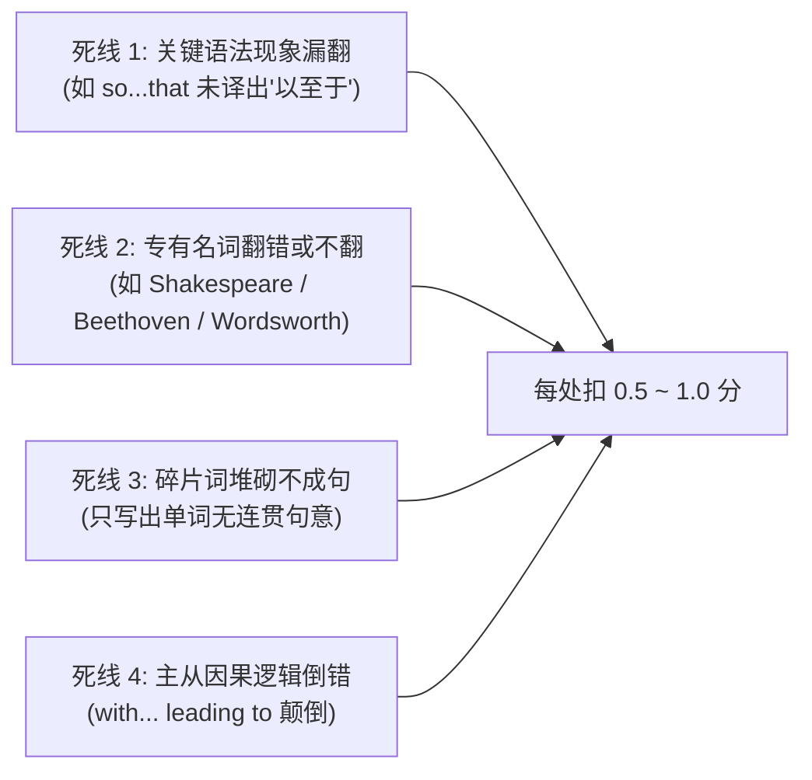
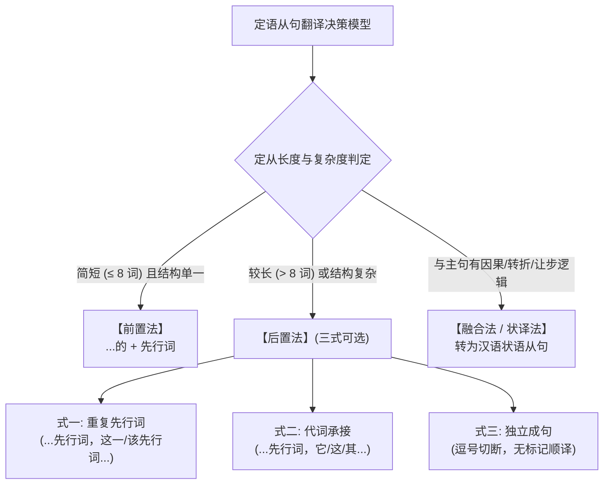

# 考研英语二翻译特点与核心方法论深度精要

> **版权与提炼说明**：本文件系统萃取自考研英语翻译名师（唐静等）基础班/强化班讲义、历年英二真题带练、英二专项八大翻译技巧及官方阅卷采分标准（源自 11 篇精讲讲义与字幕资料）。
> 本文完全独立于代码工程与 Skill 框架，专注于**考研英语二翻译的学科特征、英汉对比第一性原理、长难句结构转换模型、八大实战技巧与经典真题切片实操**，为备考与教学提供最扎实、成体系的知识资产。

---

## 目录 (Table of Contents)

- [一、考研英语二翻译题型本质与考情全景透视](#一考研英语二翻译题型本质与考情全景透视)
  - [1.1 考试大纲定位与考题规格](#11-考试大纲定位与考题规格)
  - [1.2 英二 vs 英一翻译的四大本质差异](#12-英二-vs-英一翻译的四大本质差异)
  - [1.3 官方评卷三大最高指导原则](#13-官方评卷三大最高指导原则)
  - [1.4 采分点分布与四大扣分死线](#14-采分点分布与四大扣分死线)
- [二、底层方法论：唐静“拆分与组合”第一性原理](#二底层方法论唐静拆分与组合第一性原理)
  - [2.1 英汉语言四大底层对比思维](#21-英汉语言四大底层对比思维)
  - [2.2 “拆分”的核心控制原则与四大切分点](#22-拆分的核心控制原则与四大切分点)
  - [2.3 翻译实战三步法标准化流程 (SOP)](#23-翻译实战三步法标准化流程-sop)
- [三、五大核心语法结构的长难句翻译转化公式](#三五大核心语法结构的长难句翻译转化公式)
  - [3.1 定语从句（Attributive Clause）终极翻译法则](#31-定语从句attributive-clause终极翻译法则)
  - [3.2 形式主语与形式宾语（Dummy/Formal Subject & Object）](#32-形式主语与形式宾语dummyformal-subject--object)
  - [3.3 同位语与同位语从句（Apposition & Appositive Clause）](#33-同位语与同位语从句apposition--appositive-clause)
  - [3.4 状语从句与长状语（Adverbial Clause & Long Modifiers）](#34-状语从句与长状语adverbial-clause--long-modifiers)
  - [3.5 被动语态（Passive Voice）的汉化去硬处理](#35-被动语态passive-voice的汉化去硬处理)
- [四、英二专项八大翻译技巧与“说人话”去翻译腔指南](#四英二专项八大翻译技巧与说人话去翻译腔指南)
  - [4.1 技巧一 · 专有名词（约定俗成 / 音译 / 身份补全 / 保留）](#41-技巧一--专有名词约定俗成--音译--身份补全--保留)
  - [4.2 技巧二 · 代词指代还原（避免歧义与逻辑断层）](#42-技巧二--代词指代还原避免歧义与逻辑断层)
  - [4.3 技巧三 · 一词多义与语境推导（击破熟词生义与动词短语）](#43-技巧三--一词多义与语境推导击破熟词生义与动词短语)
  - [4.4 技巧四 · 词性转换（名转动 / 介转动 / 形副转换）](#44-技巧四--词性转换名转动--介转动--形副转换)
  - [4.5 技巧五 · 增词与减词（补充隐含范畴 / 剔除语言赘肉）](#45-技巧五--增词与减词补充隐含范畴--剔除语言赘肉)
  - [4.6 技巧六 · 调整语序（重置时序、逻辑与修饰重心）](#46-技巧六--调整语序重置时序逻辑与修饰重心)
  - [4.7 技巧七 · 被动转主动（消除机械“被”字）](#47-技巧七--被动转主动消除机械被字)
  - [4.8 技巧八 · “说人话”与去翻译腔（读出声法则与润色口诀）](#48-技巧八--说人话与去翻译腔读出声法则与润色口诀)
- [五、经典真题例句精析与采分点拆解实操库](#五经典真题例句精析与采分点拆解实操库)
  - [5.1 2023 年英二真题《华兹华斯与自然诗歌》逐句精解](#51-2023-年英二真题华兹华斯与自然诗歌逐句精解)
  - [5.2 2010 年英二真题《泰德·宁与可持续性》（首考范式）长难句示范](#52-2010-年英二真题泰德宁与可持续性首考范式长难句示范)
  - [5.3 基础班经典高频结构带练金句](#53-基础班经典高频结构带练金句)
- [六、考场实操节奏与译后自查清单 (Checklist)](#六考场实操节奏与译后自查清单-checklist)
  - [6.1 考场 12~18 分钟时间分配法](#61-考场-1218-分钟时间分配法)
  - [6.2 译后必查 6 项硬死线清单](#62-译后必查-6-项硬死线清单)

---

## 一、考研英语二翻译题型本质与考情全景透视

### 1.1 考试大纲定位与考题规格

- **试卷位置**：全国硕士研究生招生考试《英语（二）》（代码 204）试卷的 **Section Ⅲ Translation**。
- **分值与量化指标**：满分 **15 分**（占整卷 15%）；阅读量通常为 **150 词左右** 的一个或若干个连续段落（微语篇）。
- **考题要求**：`Directions: Translate the following text into Chinese. Write your translation on the ANSWER SHEET. (15 points)`
- **学科定位与保分预期**：
  翻译题属于典型的“**正面硬刚型**”题型，没有选择题的碰运气成分。对于绝大多数英二考生而言，翻译是全卷提分性价比最高、得分方差最小的板块。
  - **保底分数线**：只要掌握基本词汇且完整写出汉语，可得 7~8 分；
  - **核心目标分**：贯彻“拆分组合”与“说人话”技巧，稳定斩获 **10~13 分**；
  - **满分高标**：14~15 分（要求词义贴切自然、完全消解翻译腔、句式节奏严丝合缝）。

---

### 1.2 英二 vs 英一翻译的四大本质差异

许多考生常将英一与英二翻译混为一谈，导致备考方向偏差。二者在命题哲学与应对策略上存在本质分野：

| 维度 | 考研英语（一）翻译 (Section C) | 考研英语（二）翻译 (Section Ⅲ) | 英二应对启示 |
| :--- | :--- | :--- | :--- |
| **考查形式** | 在 400 词长文中抽离出 **5 个孤立的长难句**，单句计分（每句 2 分，共 10 分） | **全篇连续微语篇翻译**（整段或 2~3 段，共约 150 词），整段综合计分（满分 15 分） | 英二具有极其丰富的上下文依托，严禁割裂上下文孤立硬译，代词与连接词须瞻前顾后 |
| **题材与语域** | 偏重学术理论、科学哲学、历史学方法论、法理学、认识论等抽象晦涩题材 | 贴近现代社会生活、个人心路历程、商业经济、科普新知、文学艺术小品 | 语域平实具体，多叙事、描写与浅显议论，严禁使用晦涩学术生僻词生搬硬套 |
| **句法复杂度** | **“长句套长句、从句层层嵌套”**，多重插入语、倒装句、同位语嵌套、割裂主谓 | **以并列复合句和中型复合句为主**，长句往往由 2~3 个中等从句或短语并列组成 | 句式更规整，只要切开主干与修饰，极易理清脉络，得分门槛大幅低于英一 |
| **阅卷与容错** | 踩点极其严苛，一个抽象词译错或长从句挂错即扣 0.5 分，全国平均分常年仅 3~4 分 | 更加注重**全文主旨连贯与汉语可读性**，采分点更细密，全国平均分普遍在 9~10 分 | 坚持“信”与“达”，把每个小句子说通顺，不放弃任何一个词汇的合理推导 |

---

### 1.3 官方评卷三大最高指导原则

阅卷专家在判定一份英译汉试卷时，遵循以下三大第一性原则（按执行权重排序）：

```
【第一原则：理解准确】 ──> 【第二原则：信息完整】 ──> 【第三原则：表述通顺】
（无事实误解/无逻辑颠倒）    （修饰不漏/关键语法标志全）    （符合汉语习惯/说人话去腔）
```

1. **理解准确（信）**：
   - 绝不能歪曲原文事实：主谓宾关系必须清晰，施动者与受动者不可颠倒。
   - 绝不能搞反肯定与否定：如否定转移、双重否定、双重比较（`no more than` vs `not more than`）必须精准落地。
   - 绝不能搞反逻辑因果：谁是因、谁是果，条件与让步关系必须严格保真。
2. **信息完整（达）**：
   - 考研翻译是“按点给分、按错扣分”。一个长句中往往蕴含 2~3 个具体采分点（如一个特定短语、一个定语从句、一个固定搭配）。
   - 严禁随意漏译关键状语（时间、地点、方式）、从句引导词或修饰限定词。
3. **表述通顺（雅之化境：说人话）**：
   - 严禁将英语的结构直接照搬进汉语。英汉语序不同、习惯不同；
   - 译文必须是规范、现代、通俗、流畅的汉语，读者无需倒推英文即可读懂并理解。

---

### 1.4 采分点分布与四大扣分死线

在阅卷实践中，阅卷老师通常以 0.5 分为最小扣分单位。以下四大“致命死线”会导致断崖式失分：



- **死线 1 · 关键语法现象/句型未翻出（直接扣分）**：
  - *典型案例*：`He read so passionately that his parents had to institute a new reading policy...`
  - *致命失误*：写成“他读得非常入迷，他的父母制定了新规定”。虽然语义上看似讲得通，但考点在于 `so...that...`（如此……以至于……），未明确体现因果程度语法标志，直接扣 0.5 分。
  - *正解*：他读得**如此**入迷，**以至于**他的父母不得不制定一项新的阅读规定……
- **死线 2 · 约定俗成专有名词翻译错误（零容忍）**：
  - 人名、地名、著名历史文化概念大纲有明文规定。
  - 莎士比亚（Shakespeare）、贝多芬（Beethoven）、比尔·盖茨（Bill Gates）、华盛顿（Washington）、硅谷（Silicon Valley）、浪漫主义（Romanticism）必须字字精准，翻错一个字直接扣分。
  - 若遇非知名人物（如作家 James Herriot），允许规范音译（詹姆斯·赫里奥特/海洛特），读音大体吻合即可得分，严禁空置不翻。
- **死线 3 · 碎片单词罗列、连不成有意义的完整句子（零分陷阱）**：
  - 考研翻译评分强调“**词汇与句意并重**”。若考生仅在草稿纸上把自己认识的 3~4 个单词写下来摆在答题卡上，彼此毫无主谓动宾逻辑，该小分句判定为 0 分。
- **死线 4 · 句子主从与因果逻辑倒错**：
  - *典型案例*：`...with the gap widening, leading to serious consequences.`
  - *致命失误*：将伴随状语与分词结果状语的逻辑链颠倒，译成“随着导致了严重后果，这一差距正在拉大”。因果链断裂，严重扣分。

---

## 二、底层方法论：唐静“拆分与组合”第一性原理

### 2.1 英汉语言四大底层对比思维

做不好翻译的根本病灶，在于“拿汉语的思维生搬英语的句子”，或者“拿英语的壳套汉语的词”。深刻理解英汉语言差异，是解构翻译题的哲学基础：

```
┌─────────────────────────────────────────────────────────────┐
│                      英汉语言特征对比矩阵                     │
├──────────────────────┬──────────────────────────────────────┤
│ 英语语言特征 (English)│ 汉语语言特征 (Chinese)                │
├──────────────────────┼──────────────────────────────────────┤
│ 形合 (Hypotaxis)     │ 意合 (Parataxis)                     │
│ 靠连接词、从句引导词搭长句│ 靠语序、意思顺承与逗号成句，短句连缀 │
├──────────────────────┼──────────────────────────────────────┤
│ 物称 (Impersonal)    │ 人称 (Personal)                      │
│ 习惯无生命、抽象概念作主语 │ 习惯以人为主语，或使用无主句         │
├──────────────────────┼──────────────────────────────────────┤
│ 静态/抽象 (Noun-heavy)│ 动态/具体 (Verb-heavy)               │
│ 名词化倾向重，大量使用介词 │ 动词极其活跃，流水句、连动式、动宾结构│
├──────────────────────┼──────────────────────────────────────┤
│ 树状嵌套 (Branching) │ 线性竹节 (Linear Bamboo)             │
│ 主干在前，定状后置层层修饰 │ 按时间先后、前因后果由先至后顺序铺开 │
└──────────────────────┴──────────────────────────────────────┘
```

1. **形合 vs 意合**：
   - 英语就像搭积木，每一个修饰成分都必须有语法螺栓（`that`, `which`, `because`, `in which`, `when`）；
   - 汉语就像流水，不需要复杂的从句引导词，依靠逗号将一个个 4~8 字的小分句串联，语义自然显现。
2. **物称 vs 人称**：
   - 英语喜用物作主语（如 `The sight of the ruins filled him with sorrow.`）；
   - 汉语喜用人作主语或无主句（“他一看到废墟，心中便充满了悲伤”，而非“废墟的景象充满了他的悲伤”）。
3. **静态抽象 vs 动态具体**：
   - 英语善用名词化（Nominalization），如 `His refusal of our invitation surprised everyone.`；
   - 汉语直接用动词：“他**拒绝**了我们的邀请，这让大家都很意外。”
4. **树状嵌套 vs 线性竹节**：
   - 英语是一棵大树，主干立在最前，枝叶（后置定语、状语从句、分词短语）挂在后面；
   - 汉语是一节一节的竹子，按照时空顺序、逻辑顺序一节一节往前长。翻译的过程，就是**把英语的大树砍断，劈成汉语的竹节**。

---

### 2.2 “拆分”的核心控制原则与四大切分点

#### 拆分最大控制原则
> **“拆出主句，拆出修饰；以 3~4 个意群为最佳粒度，每小节 2~3 个英文核心词。”**

一句话千万不要尝试一口气读完直接翻。考研长难句通常在 25~35 词之间，必须将其精准解构成 3~4 个独立小短句。

#### 拆分的四大黄金切分点

```
┌─────────────────────────────────────────────────────────────┐
│                    长难句拆分四大抓手                        │
├─────────────────────────────────────────────────────────────┤
│ 1. 标点符号：逗号 (,)、分号 (;)、破折号 (——)、冒号 (:)     │
│ 2. 连词：并列连词 (and/but/or/yet) 与从属连词 (that/which) │
│ 3. 介词短语：长介词短语充当状语或后置定语处               │
│ 4. 非谓语动词：-ing 分词短语、-ed 过去分词短语、to do 结构   │
└─────────────────────────────────────────────────────────────┘
```

1. **标点符号处切断**：凡有逗号、分号、破折号的地方，90% 都是天然的语意停顿点，大胆切开。
2. **连词引导处切断**：
   - 并列连词（`and`, `but`, `while`, `or`）前后连接两个并列分句或动词；
   - 从属连词（`that`, `which`, `who`, `when`, `if`, `although`, `because`）引导的从句起头处切断。
3. **长介词短语处切断**：位于句首、句末或插入语位置的长介词短语（如 `in the late eighteenth century`, `with the boom and burst of...`）。
4. **非谓语动词起首处切断**：现在分词短语（伴随/结果）、过去分词短语（后置定语/状语）、不定式短语处切断。

---

### 2.3 翻译实战三步法标准化流程 (SOP)

唐静老师总结的“翻译三步做题法”，是考场提速、提质的标准化操作管线：

```
┌──────────────────────────────────────────────────────────────┐
│                    翻译实战三步法标准化流程                  │
├──────────────────────────────────────────────────────────────┤
│ 步骤一：对照写词（抓主干 · 锁动词 · 标生词 · 辨专名）         │
│          ▼                                                   │
│ 步骤二：意群造短句（小句子成型 · 局部直译 · 不留空白）        │
│          ▼                                                   │
│ 步骤三：组合润色成大句（调整语序 · 前因后果 · 说人话消去腔）  │
└──────────────────────────────────────────────────────────────┘
```

#### 步骤一：对照写词（抓主干，锁定生词与专名）
- 拿到句子后，先用斜杠 `/` 完成拆分；
- 对照英文，把认识的单词和主干核心词直接在草稿纸上写出中文对应；
- **核心重点盯防动词短语**：动词是句子的灵魂。动词短语一旦译错，全句崩塌。
  - `rest upon`：千万不能译成“在……上面休息”，而是“**依靠、依赖、取决于**”；
  - `eat up`：不是“吃上去”，而是“**吃光、消耗殆尽**”；
  - `jump to`：不是“跳到”，而是“**匆忙作出、急忙转入**”；
  - `fail to do`：不是“做某事失败”，而是“**未能做成某事 / 没有做某事**”；
  - `became famous for`：不是字面的“变得有名为了”，而是“**因……而闻名于世 / 著称**”。

#### 步骤二：意群造短句（写出局部小句子）
- 针对切分开的每一个小意群，用 2~3 个中文词将其连缀成局部通顺的小短句；
- 在此阶段允许带有生硬感，核心目标是**确保信息无遗漏、语法关系无偏差**。

#### 步骤三：组合润色成大句（通达与“说人话”）
- 将各个小短句按照汉语逻辑串联起来：
  - 检查状语是否需要提前（把句末的时间、条件、原因状语移至主干前）；
  - 检查定语从句是否过于冗长（太长则后置独立成句，短则前置加“的”）；
  - 检查被动语态是否生硬（将“被”字替换为主动或无标记句）；
  - 朗读检验：读一遍，看看舌头打不打结，如果不顺畅，立刻微调修饰。

---

## 三、五大核心语法结构的长难句翻译转化公式

考研英二翻译中，70% 以上的失分都集中在以下五大核心语法结构的处理上。掌握以下公式，即可实现模块化精准破局。

---

### 3.1 定语从句（Attributive Clause）终极翻译法则

定语从句是考研翻译中出现频次最高、分值最大的语法点。



#### 法则一：前置法（...的 + 先行词）
- **适用场景**：定语从句极为简短（通常在 8 个单词以内），且修饰关系单一，前置后不会造成汉语主语或宾语头重脚轻。
- **经典范式**：
  - *英文*：`...his poems about nature which made him famous.`
  - *处理*：使他成名的（定从） + 有关大自然的诗歌（先行词）。
  - *译文*：他那些**使他闻名于世的**有关大自然的诗歌。

#### 法则二：后置法（长定从必用，杜绝汉语臃肿）
- **为什么必须后置？** 英语的修饰语无论多长都可以堆在名词后面；而汉语习惯定语在前。如果把一个包含 15 个单词、两层嵌套的定语从句硬塞在名词前面，就会出现“……的一个长达三十个字的关于什么的让人喘不过气来的定语”，这是最严重的翻译腔！
- **后置三式实操**：
  1. **式一 · 重复先行词**：在定语从句起头处，重新重复先行词，并附带“这一/该”限定词。
     - *原句*：`He signed on with a Boulder agency, which was booming at that time.`
     - *译文*：他与博尔德代理公司签了约，**这家公司**当时正处于蓬勃发展期。
  2. **式二 · 代词承接**：用“它”、“这”、“其”、“他们”承接先行词，顺流写下去。
     - *原句*：`And he was one of the founders of a movement called Romanticism, which celebrated the wonders of the natural world.`
     - *译文*：他是浪漫主义运动的创始人之一，**该运动**歌颂了大自然的美妙之处。
  3. **式三 · 独立成句（无标记顺译）**：先行词之后打逗号，定语从句直接作为并列句顺译。
     - *原句*：`“It was a really bad move,” says Ning, whose dilemma about the job translated into a lack of sales.`
     - *译文*：“那真是糟糕的一步，”宁说。**他在工作上的进退维谷**导致销售业绩不佳。

#### 法则三：融合法与状译法（非限制性定从功能化）
- **适用场景**：非限制性定语从句（由 `, which`、`, who`、`, as`、`, where` 引导），在逻辑上与主句存在因果、条件、让步或结果关系。
- **公式**：
  - 逻辑表原因：译为“**因为……**”；
  - 逻辑表结果：译为“**从而…… / 这导致……**”；
  - 逻辑表让步：译为“**尽管……**”。

---

### 3.2 形式主语与形式宾语（Dummy/Formal Subject & Object）

#### 核心口诀
> **“形式主语前置当短语，坚决不扔在句末；形式宾语拆出两层皮，主干从句各自立。”**

#### 1. 形式主语结构 (`It is + adj./n./done + that/to do...`)
许多考生习惯把 `that` 从句翻译完，再回头翻“是重要的/显然的”，导致句式极其生硬。
- **高效处理公式**：直接将开头的 `It is...` 转化为**汉语评注性副词或固定插入语**，放在句首引出下文：

| 英文原式 | 传统生硬译法 (×) | 考研高分“说人话”译法 (√) |
| :--- | :--- | :--- |
| `It is obvious that...` | ……那是显然的 | **显而易见，…… / 很显然，……** |
| `It is generally accepted that...` | ……是被普遍接受的 | **人们普遍认为，…… / 普遍的共识是，……** |
| `It turned out that...` | ……被证明出来了 | **结果表明，…… / 事实证明，……** |
| `It is true that..., but...` | ……是真的，但是…… | **诚然，……；但…… / 固然……** |
| `It has been argued that...` | ……曾经被争论过 | **有人曾主张，…… / 曾有观点认为，……** |

#### 2. 形式宾语结构 (`make / find / consider it clear that...`)
- **原句典例（2010 年英二）**：
  `Having endured a painful period of unsustainability in his own life made it clear to him that sustainability-oriented values must be expressed through everyday action and choice.`
- **切分与处理**：
  - `made it clear to him that...`：`it` 是形式宾语，真正的宾语是 `that` 引导的完整从句；
  - 转化为汉语连动结构：“**使他清楚地认识到 / 让他明白了一个道理：……**”。

---

### 3.3 同位语与同位语从句（Apposition & Appositive Clause）

#### 1. 简单名词同位语
- **短同位语**：直接前置充当修饰语，或使用破折号/括号。
  - *例*：`William Wordsworth, a famous British poet, ...` ➔ 英国著名诗人威廉·华兹华斯……
- **较长同位语**：置于先行词之后，补充“**即……**”或“**也就是……**”。
  - *例*：`...an instinct, that is, a natural tendency to...` ➔ 一种本能，**即**一种自然的倾向……

#### 2. 复杂同位语从句
同位语从句常跟在抽象名词（`fact`, `idea`, `notion`, `belief`, `evidence`, `view`, `assumption`, `conclusion`）之后，解释其具体内容。
- **简短同位语从句**：前置法，译为“**……的[事实/观念/看法]**”。
  - *例*：`The idea that nature can heal us is widely accepted.` ➔ **大自然能治愈我们这一观念**得到了普遍认可。
- **复杂长同位语从句**：后置独立法，在抽象名词后打断，加“**即：……**”引出具体内容。
  - *例*：`We must accept the fact that economic growth has its limits.` ➔ 我们必须接受这样一个事实，**即经济增长是有其极限的**。

---

### 3.4 状语从句与长状语（Adverbial Clause & Long Modifiers）

#### 语序颠倒律（汉英时空与逻辑重心差异）
- **英语特点**：主干在前，状语后置（时间、条件、原因、地点常常挂在句末）；
- **汉语特点**：先背景后动作，先因后果，先条件后结论。
- **必调语序清单**：
  1. **时间状语提前**：`I will give you a prize after finishing this work.` ➔ **完成这项工作后**，我会给你发奖。（绝不能译成：我会给你发奖，在完成这项工作后）。
  2. **原因状语提前**：`He resigned because the pressure was overwhelming.` ➔ **由于压力过大**，他选择了辞职。
  3. **条件与假设提前**：`You will succeed if you persist.` ➔ **只要坚持下去**，你就一定会成功。
- **分词状语（with / -ing / -ed）的顺承汉化**：
  当长状语表示伴随、结果或补充说明时，无需硬性提前，顺水推舟译为后续并列分句。
  - *例*：`...spending a confusing year in the late 1990s selling insurance.` ➔ 在20世纪90年代末度过了困惑的一年，**期间靠推销保险为生**。

---

### 3.5 被动语态（Passive Voice）的汉化去硬处理

汉语极少使用被动标记词（“被”），生硬套用“被”字会导致浓厚的机械翻译腔。考研翻译中掌握被动语态汉化的**四大破法**：

```
┌─────────────────────────────────────────────────────────────┐
│                    被动语态汉化四大破法                      │
├─────────────────────────────────────────────────────────────┤
│ 1. 施动者转主语（主宾对调法）                              │
│    例: His voice is favored by students. ➔ 同学们很喜欢他的嗓音│
├─────────────────────────────────────────────────────────────┤
│ 2. 无标记主动句（汉语隐性被动）                             │
│    例: The problem has been resolved. ➔ 问题已经解决。       │
├─────────────────────────────────────────────────────────────┤
│ 3. 汉语公文助动词替换（由 / 受 / 遭 / 蒙受 / 予以 / 加以 / 据）│
│    例: He was criticized. ➔ 他受到了批评。                  │
├─────────────────────────────────────────────────────────────┤
│ 4. 转换为无主句 / 客观判断句                                │
│    例: It is said that... ➔ 据说…… / 有人说……               │
└─────────────────────────────────────────────────────────────┘
```

1. **破法一 · 施动者转主语（主宾对调）**：
   - 寻找 `by` 后面的动作发出者，将其拉至句首做主语。
   - *原句*：`His work was praised by critics.` ➔ **批评家们盛赞了**他的作品（优于：他的作品被批评家赞扬）。
2. **破法二 · 无标记主动句（自然陈述）**：
   - 汉语中很多事物作主语时，天生自带被动含义，直接陈述即可。
   - *原句*：`The book is printed in Beijing.` ➔ 这本书**在北京印刷**（绝不说：这本书在北京被印刷）。
   - *原句*：`The house was built in 1990.` ➔ 这栋房子**建于1990年**。
3. **破法三 · 借助公文实词替代“被”字**：
   - 使用“**由、受、遭、蒙受、受到、获得、得以、予以、加以、据**”等词，格调高雅且自然。
   - `be inspired by...` ➔ **受……启发 / 从……中获得灵感**；
   - `be challenged by...` ➔ **面临……的严峻挑战 / 遭到……质疑**；
   - `must be expressed through...` ➔ **必须透过……才能得以体现**。
4. **破法四 · 转换为无主句**：
   - `It cannot be denied that...` ➔ **不可否认的是，……**。
   - `Steps must be taken...` ➔ **必须采取措施……**。

---

## 四、英二专项八大翻译技巧与“说人话”去翻译腔指南

字幕文档《考研英语二翻译（2）技巧》系统凝练了专门针对英语二的八大实操技巧，贯穿词汇到篇章的全过程。

---

### 4.1 技巧一 · 专有名词（约定俗成 / 音译 / 身份补全 / 保留）

专有名词是评卷时的客观硬指标，通常大写出现。四大分类处理策略如下：

```
┌─────────────────────────────────────────────────────────────┐
│                    专有名词分类处理四律                      │
├─────────────────────────────────────────────────────────────┤
│ 1. 约定俗成律：国际通用、历史名人、经典概念，一字不差       │
│    Shakespeare 莎士比亚 / Beethoven 贝多芬 / Romanticism 浪漫主义 │
├─────────────────────────────────────────────────────────────┤
│ 2. 规范音译律：非通晓人名、一般地名，选取发音相近规范汉字   │
│    James Herriot 詹姆斯·赫里奥特 / Boulder Agency 博尔德代理公司 │
├─────────────────────────────────────────────────────────────┤
│ 3. 身份补全律：单纯音译不知所云时，结合上下文补全范畴词     │
│    Ning ➔ 宁（若在首段可称“泰德·宁”，后文用“宁”）           │
├─────────────────────────────────────────────────────────────┤
│ 4. 原文保留与释义律：拉丁短语、罕见公式代号保留并翻译说明   │
│    Latin phrase 'sapere aude' or dare to know               │
│    ➔ 拉丁语短语“sapere aude”，即“勇于求知”                  │
└─────────────────────────────────────────────────────────────┘
```

> [!CAUTION]
> **名师警示**：贝多芬（Beethoven）万万不可凭空拼写成“闭塞粉”；硅谷（Silicon Valley）不可译为“硅的大峡谷”。对于未知名人，可音译其名并补上“……作家”、“……学者”，确保读者理解。

---

### 4.2 技巧二 · 代词指代还原（避免歧义与逻辑断层）

英语极其忌讳名词重复，因此通篇充斥着 `it`, `they`, `he`, `she`, `this`, `that`, `these`, `those`。而汉语恰恰相反，汉语不怕名词重复，最怕指代不清。

#### 实操法则
1. **无歧义时直译**：句子简短，且只有一个单数阳性/阴性主语时，直接译为“他/她/它”。
2. **多主体、跨句、有歧义时必须“显性还原”**：
   - 如果代词与所指代的名词之间隔了一个从句，或者上一句出现了两个复数名词；
   - 必须**根据就近原则与逻辑一致原则，回溯还原为该名词的具体中文名称**！
   - *典型案例*：`The company launched a new policy for workers, and it was welcomed.`
     - 生硬直译：“公司为工人推出了新政策，它受到了欢迎。”（歧义：“它”指公司还是政策？）
     - 还原正解：“公司为工人们推出了一项新政策，**这项政策**受到了广泛欢迎。”

---

### 4.3 技巧三 · 一词多义与语境推导（击破熟词生义与动词短语）

考研英语二的词汇难点，不在于偏难怪的大纲超纲词，而在于**初高中常见基础词汇的“学术语境生义”**。

```
┌─────────────────────────────────────────────────────────────┐
│                    高频熟词生义语境推导清单                  │
├──────────────┬──────────────────┬───────────────────────────┤
│ 词汇 / 短语   │ 大纲第一词义 (×) │ 考研学术与翻译真实现境 (√)│
├──────────────┼──────────────────┼───────────────────────────┤
│ celebrate    │ 庆祝，祝贺       │ 歌颂，颂扬，赞美          │
│ wonder       │ 想知道，怀疑     │ 奇观，美妙之处，壮丽景象  │
│ institute    │ 研究所，学院     │ 建立，制定，实行（法规/政策）│
│ rest upon    │ 在……上休息       │ 依靠，取决于，以……为基础  │
│ jump to      │ 跳到……           │ 匆忙作出（结论），急忙转向│
│ fail to      │ 失败做某事       │ 未能……，没有……          │
│ eat up       │ 吃上去           │ 吃光，耗尽，吞噬          │
│ dilemma      │ 两难境地         │ 进退维谷，左右为难，尴尬处境│
│ policy       │ 政治，保单       │ （家庭/机构内）规矩，规定 │
└──────────────┴──────────────────┴───────────────────────────┘
```

#### 推导代入检验法
如果把常用意思放进句子发现语意滑稽（如“华兹华斯的诗歌庆祝了大自然的想知道”），立刻启动**同根词/派生词联想法**：
- `wonder` ➔ 想到形容词 `wonderful`（美妙的、奇妙的）➔ 推导名词为“**美妙之处、奇妙之物**”；
- `celebrate` ➔ 华兹华斯是浪漫主义诗人，浪漫主义崇尚大自然 ➔ 诗人对大自然只能是“**歌颂与颂扬**”。

---

### 4.4 技巧四 · 词性转换（名转动 / 介转动 / 形副转换）

汉语是动词主导型语言，英语是介词与名词主导型语言。灵活转换词性，是摆脱学生腔的关键。

1. **名词转化为动词（最核心）**：
   - 英语中大量带有 `-tion`, `-ment`, `-ance` 的抽象动作名词，翻译时直接剥除名词外衣，变为纯动词。
   - `His dilemma translated, predictably, into a lack of sales.`
     - *直译*：他的窘境可预见地翻译成了销售的缺乏。
     - *词性转换*：不出所料，工作上的进退维谷**造成**了他销售业绩**不佳**。
   - `with the aim of promoting mutual understanding` ➔ 旨在**增进**相互理解。
2. **介词转化为动词**：
   - 英语介词承载了丰富的方向与动作含义。
   - `He went through boom and burst.` ➔ 他**经历**了繁荣与破灭。
   - `...a painful period of unsustainability in his life.` ➔ 他生活中一段**难以承受**的痛苦时期。
3. **形容词转化为动词或副词**：
   - `be desperate for a job` ➔ **急需**一份工作 / **迫切渴望得到**一份工作。

---

### 4.5 技巧五 · 增词与减词（补充隐含范畴 / 剔除语言赘肉）

#### 1. 增词法（增语义不增信息）
- **增补概念范畴词**：英语常单个抽象名词独立出现，汉语习惯在后面挂上“**现象、行为、举措、局势、趋势、过程**”。
  - *原词*：`unsustainability` ➔ 不可承受**的状态 / 局面**；
  - *原词*：`anxiety` ➔ 焦虑**情绪 / 焦虑感**。
- **增补逻辑连接词**：英汉转换时，补充“**因此、然而、其实、显而易见**”，使句与句的逻辑粘合度更高。
- **增补隐含主语**：英语分词短语或无主句，汉语中需把主语“**他 / 人们 / 我们**”补足。

#### 2. 减词法（脱水去肿）
- **削减冗余代词**：英语几乎每个名词前都有 `his`, `her`, `their`, `its`。汉语通通不需要！
  - *原句*：`He put his hands into his pockets and closed his eyes.`
  - *生硬*：他把他的双手插进了他的口袋里，闭上了他的眼睛。
  - *精炼*：他双手插兜，闭上了眼睛。（削减了 3 个无意义的“他的”）。
- **削减虚词与冠词**：`the`, `a`, `an` 除非强调“某一个”，否则绝不机械翻译成“一个”。

---

### 4.6 技巧六 · 调整语序（重置时序、逻辑与修饰重心）

- **前因后果调序**：英语常“先结果后原因”（主句 + because从句），汉语优先“因为……所以……”。
- **先状后主调序**：时间、地点、方式状语挪至主语前后，不得拖在句尾。
- **倒装与插入语归位**：
  - *原句*：`“It didn't go well,” says Ning.` ➔ 宁说：“情况并不顺利。”（将后置的引用动词移至前部或中间）。

---

### 4.7 技巧七 · 被动转主动（消除机械“被”字）

- 彻底排查译文中所有的“被”字；
- 90% 的“被”字都可以通过**主宾对调**、**无标记主动**、**换用‘由/受/遭/蒙受’**将其抹去；
- 只有在真正表示受害、不情愿的特定语境下，才保留“被”字。

---

### 4.8 技巧八 · “说人话”与去翻译腔（读出声法则与润色口诀）

#### 去除翻译腔的“读出声法则”
> **“大声朗读你的译文！凡是舌头打结、气喘不上来、语序别扭、自己读着都觉得不是阳间中文的地方，必有翻译腔！”**

#### 翻译腔三大典型病灶与药方
1. **“的”字泛滥成灾**：一句话出现超过 3 个“的”。
   - *药方*：删除非必要“的”，将长定语拆分成独立小短句。
2. **连接词机械呆板**：每句开头都是“当……的时候”、“因为……所以……”。
   - *药方*：用自然语序代替连接词，靠逻辑顺序自然推进。
3. **主谓间距过远（头重脚轻）**：主语后面挂着长达十几词的后置修饰，隔了很久才出现谓语。
   - *药方*：切断修饰，先出主谓，修饰语后置独立交待。

---

## 五、经典真题例句精析与采分点拆解实操库

### 5.1 2023 年英二真题《华兹华斯与自然诗歌》逐句精解

本篇真题为典型的文学艺术史题材，是英二考查“叙述 + 评论”微语篇的典范。

#### 【第 1 句】
- **英文原句**：
  > `In the late eighteenth century, William Wordsworth became famous for his poems about nature.`
- **模块化断句切分**：
  - `[1]` In the late eighteenth century,（时间状语）
  - `[2]` William Wordsworth became famous for（主句主谓系表）
  - `[3]` his poems about nature.（介词宾语及定语修饰）
- **核心采分点剖析**：
  - `William Wordsworth`：约定俗成英国浪漫主义诗人“**威廉·华兹华斯**”（音译必须精准）；
  - `became famous for`：动词系表搭配，不可直译为“为了……变得出名”，而应译为“**因……而闻名于世 / 著称**”；
  - `poems about nature`：定语前置，“**有关大自然的诗歌**”。
- **优质参考译文**：
  > **18世纪晚期，威廉·华兹华斯因其有关大自然的诗歌而闻名于世。**

---

#### 【第 2 句】
- **英文原句**：
  > `And he was one of the founders of a movement called Romanticism, which celebrated the wonders of the natural world.`
- **模块化断句切分**：
  - `[1]` And he was one of the founders（并列主干一）
  - `[2]` of a movement called Romanticism,（后置分词定语）
  - `[3]` which celebrated the wonders of the natural world.（非限制性定语从句）
- **核心考点与采分陷阱**：
  - `founders`：奠基人、创始人；
  - `called Romanticism`：被称为“**浪漫主义**”的运动；
  - `which...` 定从后置处理：修饰语较长，采用后置法第二式（代词承接），将 `which` 还原为“**这一运动 / 该运动**”；
  - **熟词生义核心题眼**：
    - `celebrated`：决不能译为“庆祝了”，诗歌流派对自然是“**赞美 / 歌颂 / 颂扬**”；
    - `wonders`：决不是“想知道”，而是“**奇观 / 美妙之处 / 壮丽景色**”。
- **病态死译对比**：
  - *劣质翻译 (×)*：并且他是被称为浪漫主义的运动的创始人之一，这个运动庆祝了自然界想知道的事情。（翻译腔严重，熟词生义全军覆没）
- **优质参考译文**：
  > **同时，他还是浪漫主义运动的创始人之一；该运动极力歌颂大自然的美妙与奇观。**

---

### 5.2 2010 年英二真题《泰德·宁与可持续性》（首考范式）长难句示范

2010 年是考研英语二统考第一年，其翻译篇章奠定了英二的命题基调（以当代人物经历展现成长哲理）。

#### 【长难句题眼】
- **英文原句**：
  > `Having endured a painful period of unsustainability in his own life made it clear to him that sustainability-oriented values must be expressed through everyday action and choice.`
- **模块化断句剖析**：
  - `[1]` Having endured a painful period of unsustainability in his own life（现在分词完成时短语充当整句主语）
  - `[2]` made it clear to him（谓语 + 形式宾语 + 宾补）
  - `[3]` that sustainability-oriented values must be expressed（真正宾语从句主干，被动语态）
  - `[4]` through everyday action and choice.（方式状语）
- **高阶技法解密**：
  - **长主语动态化**：主语是一个极长的分词短语，若译为“……这件事使他……”，很呆板。转换为时间状语或因果顺叙：“**在亲身经历了一段……之后，他清楚地认识到……**”；
  - `unsustainability` 增词转化：词性转换与范畴词增补，译为“**难以维系 / 难以承受的生活**”；
  - `made it clear to him that...`：形式宾语化解为“**让他明白了一个道理 / 让他清楚地认识到**”；
  - `must be expressed through...`：被动去硬处理，使用公文词“**得以体现 / 才能得到落实**”。
- **优质参考译文**：
  > **在经历了一段难以维系的痛苦生活后，他清楚地认识到：唯有透过日常的一言一行与抉择，以可持续发展为导向的价值观才能真正得以体现。**

---

### 5.3 基础班经典高频结构带练金句

唐静老师精讲讲义中针对定从、同位语与形主遴选的代表性金句总结：

1. **定语从句后置之“重复先行词法”**：
   - *原句*：`He developed a new theory, which theory was later proved correct.`
   - *技法*：重复“这一理论”，杜绝塞在句首。
2. **同位语从句之“即”字引出法**：
   - *原句*：`We are faced with the harsh fact that resources are depleting rapidly.`
   - *译文*：我们正面临着一个严峻的事实，**即资源正在迅速耗竭**。
3. **形式主语前置副词法**：
   - *原句*：`It is widely acknowledged that education plays a pivotal role in personal success.`
   - *译文*：**普遍认为**，教育在个人的成功中发挥着关键作用。

---

## 六、考场实操节奏与译后自查清单 (Checklist)

### 6.1 考场 12~18 分钟时间分配法

在整场 180 分钟的考研英语二考试中，翻译模块的推荐建议用时为 **15 分钟**（上下浮动不超过 3 分钟）：

```
┌─────────────────────────────────────────────────────────────┐
│                 考场 15 分钟黄金节奏分配模型                │
├─────────────────────────────────────────────────────────────┤
│ 第 1~2 分钟  │ 通读全篇 · 抓定主旨                          │
│              │ 快速略读首段与末句，判断文体题材与感情色彩     │
├──────────────┼─────────────────────────────────────────────┤
│ 第 3~12 分钟 │ 逐句拆分 · 落实初译                          │
│              │ 用铅笔划线断句，先写意群草稿，再通顺誊写正卷   │
├──────────────┼─────────────────────────────────────────────┤
│ 第 13~15 分钟│ 全文复读 · 闭环自查                          │
│              │ 对照 6 项死线清单，彻底消灭别扭与翻译腔       │
└─────────────────────────────────────────────────────────────┘
```

---

### 6.2 译后必查 6 项硬死线清单

交卷前或模拟练习结束后，对照此清单逐项“过筛子”：

- [ ] **1. 漏译排查**：是否漏掉了句末的某个介词短语状语？`so...that`、`not only...but also` 等成对连词是否两头都译出了？
- [ ] **2. 专名核对**：卷中的人名、地名、学派名是否遵从了约定俗成？没有自创奇怪的谐音字？
- [ ] **3. 代词除歧**：文中所有的“他/它/他们”，其指代对象在中文语境中是否一目了然？是否存在多重名词指代混淆？
- [ ] **4. 被动去硬**：全文是否充斥着别扭的“被”字？能否用“由/受/遭到/得以”或无标记主动句化解？
- [ ] **5. 语序通达**：时间状语、条件状语是否挪到了主干前？长定语是否果断断开后置成句？
- [ ] **6. 终极朗读**：合上英文原题，仅看自己写出的中文，通篇快速默读一遍——**这究竟是不是一篇中国人写的正常文章？** 读懂了，12分就稳了！
